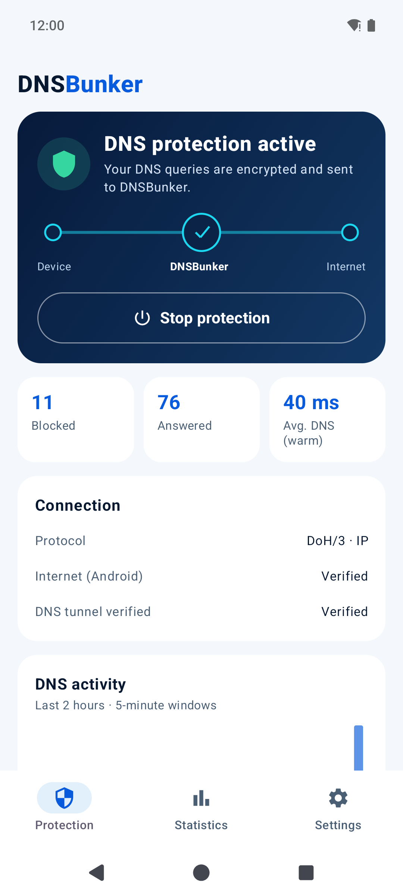
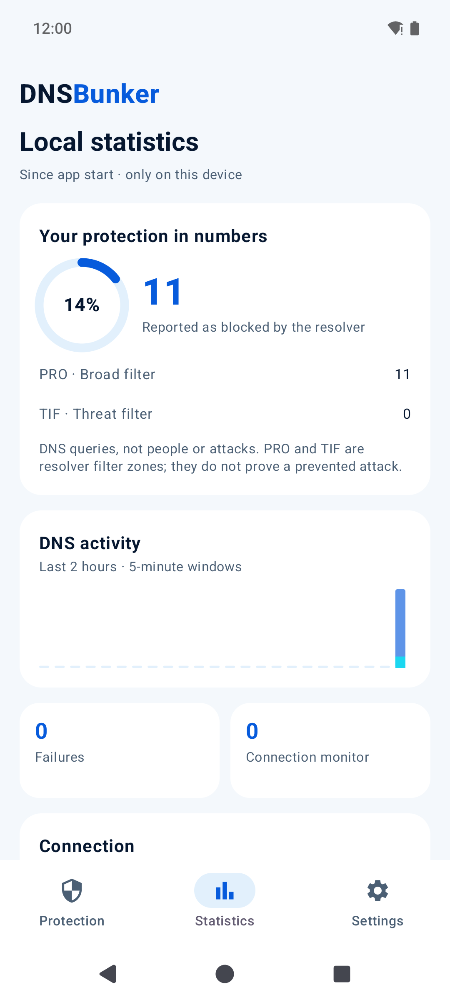
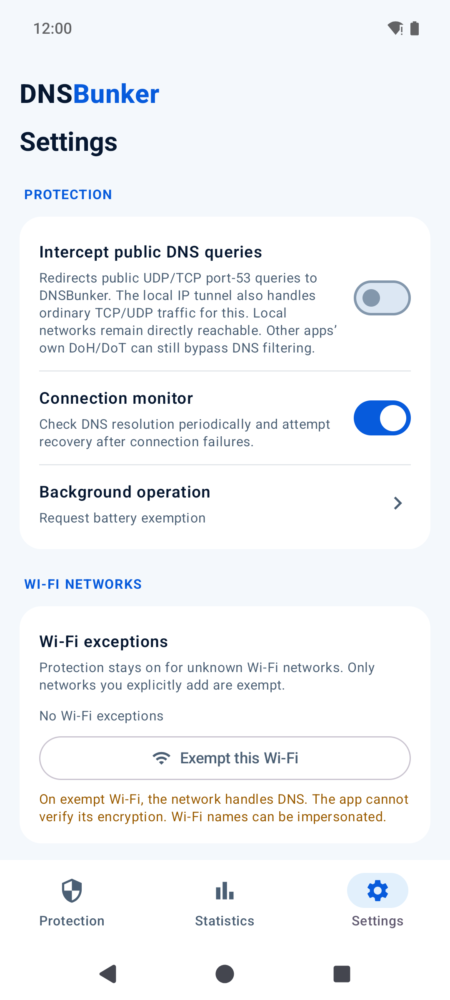

# DNSBunker for Android

Encrypted DNS for Android (5.0 and newer) with the filtering resolver of [dnsbunker.org](https://dnsbunker.org). A local VPN receives Android's system DNS queries and forwards them only over encrypted, certificate-verified connections. All other traffic keeps going directly to its destination.

<p>



</p>

## Features

- DNS over HTTPS (HTTP/2 and HTTP/3), DNS over QUIC and DNS over TLS, each with hostname SNI or certificate-verified IP identity
- No plaintext fallback: without a working encrypted upstream, queries fail with SERVFAIL
- Optional comprehensive mode: an on-device gVisor network stack also redirects apps that send DNS to public servers on port 53; there is no remote VPN exit and no TLS interception
- Live statistics kept only in memory: answered and blocked queries, PRO/TIF filter categories, response times
- Wi-Fi exceptions, local name protection (`home.arpa`, `.local`, private reverse zones) and optional router DNS for trusted Wi-Fi networks
- Automatic recovery after network changes, connection monitor, EDNS padding
- Starts again by itself after app updates and phone restarts; Quick Settings tile; warning when another VPN takes over
- Updates itself from the GitHub releases after verifying the SHA-256 checksum and the signing certificate (can be turned off)
- Runs on Android 5.0 and newer
- No ads, no trackers, no telemetry, no account; Android backups disabled
- English, German, French, Spanish and Russian

Apps that bring their own encrypted DNS (for example some browsers) are not covered by any system DNS protection.

## Download

- Signed APKs: [GitHub releases](https://github.com/DNSBunker/DNSBunker-Android-App/releases)
- F-Droid: submission in preparation

### Verifying a release

Every release contains `SHA256SUMS` and detached OpenPGP signatures (`.asc`) made with the DNSBunker release key:

```
C062 8376 18FD 65ED 2BED  1163 1E89 5311 330D 6DB7
```

The public key is available at <https://github.com/DNSBunker.gpg>.

```sh
curl -s https://github.com/DNSBunker.gpg | gpg --import
gpg --verify SHA256SUMS.asc SHA256SUMS
sha256sum -c SHA256SUMS
```

The APK signing certificate has the SHA-256 fingerprint

```
f13a62cbbaded75adbdc7583075b6adfa851cf7badc6dc40aa46969b5eb2ee16
```

which can be checked with `apksigner verify --print-certs DNSBunker-<version>.apk`.

## Building

Required toolchain (exact versions keep the build reproducible):

| Component | Version |
|---|---|
| JDK | 17 or 21 |
| Android SDK platform / build tools | 36 / 36.0.0 |
| Android NDK | r30 (30.0.16248370) |
| Go | 1.27.4 |

```sh
export ANDROID_HOME=/path/to/android-sdk
export ANDROID_NDK_HOME=/path/to/android-ndk-r30
./gradlew :app:assembleRelease
```

Gradle compiles the native QUIC and network stack library (`native/quic`) from source for arm64-v8a, armeabi-v7a, x86 and x86_64 before packaging; no prebuilt binaries are committed. Go modules are pinned and verified through `native/quic/go.mod` and `go.sum`.

Release builds are signed only when `DNSBUNKER_KEYSTORE`, `DNSBUNKER_STORE_PASSWORD`, `DNSBUNKER_KEY_PASSWORD` and optionally `DNSBUNKER_KEY_ALIAS` are set; otherwise an unsigned APK is produced.

### Tests

```sh
./gradlew :app:testDebugUnitTest :app:lintDebug
(cd native/quic && go test ./...)
```

Instrumented tests in `app/src/androidTest` need a device or emulator with VPN consent already granted. Live VPN tests run only with `-Pandroid.testInstrumentationRunnerArguments.liveVpn=true`. The `networkprobe` module is a separate test-only app used by the system network tests.

## How it works

The VPN interface announces two virtual DNS servers (`198.18.0.1`, `fd77:db4b::1`) and routes only those addresses into the tunnel. Queries are validated, optionally padded to 128-byte blocks and resolved over the fastest verified transport. QUIC transports are used after background health checks succeed; HTTPS over TCP remains available when UDP is blocked. Sockets are protected from the VPN and bound to an explicit physical network.

In comprehensive mode the tunnel carries public IPv4/IPv6 routes. A gVisor user-space stack answers port 53 traffic locally through the encrypted resolver and relays all other TCP/UDP connections directly from protected sockets. Private networks stay outside the tunnel unless Android lockdown mode requires full routes.

## Privacy

- [Privacy policy](https://dnsbunker.org/privacy.html)
- [Terms of service](https://dnsbunker.org/tos.html)

The app stores only its settings and the Wi-Fi names you add to rules. Statistics live in memory until the app process ends or you reset them.

## License

DNSBunker for Android is free software: you can redistribute it and/or modify it under the terms of the GNU General Public License as published by the Free Software Foundation, either version 3 of the License, or (at your option) any later version. See [LICENSE](LICENSE).

Bundled third-party components and their licenses are listed in [licenses/NOTICE.md](licenses/NOTICE.md).

---

### Kurz auf Deutsch

DNSBunker verschlüsselt die DNS-Anfragen deines Android-Geräts und schickt sie an den filternden Resolver von dnsbunker.org (DoH/2, DoH/3, DoQ, DoT, immer mit Zertifikatsprüfung, nie Klartext-Rückfall). Ein lokales VPN nimmt nur die DNS-Anfragen entgegen; der restliche Verkehr bleibt direkt. Keine Werbung, keine Tracker, keine Telemetrie. Lizenz: GPL-3.0-or-later.
